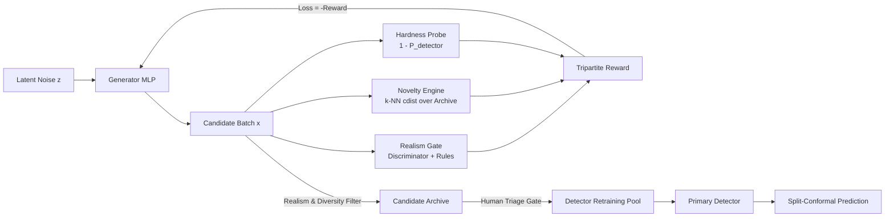

# SENTINEL
### Self-Evolving Novelty and Rare-Event Intelligence through Learning

[](https://www.python.org/)
[](https://fastapi.tiangolo.com/)
[](https://react.dev/)
[](https://tailwindcss.com/)
[](https://opensource.org/licenses/MIT)

> **MANDATORY RESEARCH DISCLAIMER:**
> **SENTINEL is a PROPOSED research framework.** It explores novelty-driven adversarial expansion to improve detector robustness on class-imbalanced benchmark datasets. **It never claims to discover real diseases or real fraud.** All synthetic candidates are explicitly watermarked `[SYNTHETIC — FICTIONAL / UNVALIDATED]`.

---

## 1. Core Architecture

SENTINEL generates plausible, novel, and hard-to-detect synthetic candidates to stress-test and expand classification boundaries in severely imbalanced regimes:

$$\mathcal{R}(\mathbf{x}) = \alpha \cdot \text{Realism}(\mathbf{x}) + \beta \cdot \text{Novelty}(\mathbf{x}) + \gamma \cdot \text{Hardness}(\mathbf{x})$$

$$\mathcal{L}_{\text{Generator}} = -\mathcal{R}(\mathbf{x})$$



1. **Realism**: Discriminator score evaluated on real data minus soft penalties for domain-specific constraint violations.
2. **Novelty**: Differentiable mean Euclidean distance to the $k$-nearest neighbors among real data and the accumulated archive ($\mathbf{X}_{\text{ref}} = [\mathbf{X}_{\text{rare}}; \mathbf{X}_{\text{archive}}]$) using `torch.cdist`.
3. **Hardness**: Exploits detector blind spots: $1.0 - P_{\text{detector}}(\text{rare} \mid \mathbf{x})$.
4. **Curriculum Scheduler**: Scales $\beta$ and $\gamma$ dynamically upward over training rounds.
5. **Diversity-Aware Archive**: Filters out near-duplicates and provides a human-in-the-loop expert triage gate.
6. **Split Conformal Prediction**: Provides guaranteed empirical coverage $(1 - \epsilon)$ on held-out calibration data.

---

## 2. Monorepo Structure

```
Sentinel/
├── backend/
│   ├── app/
│   │   ├── api/             # REST & WebSocket endpoints
│   │   ├── core/            # Generator, Discriminator, Detector, Rewards, Archive, Conformal
│   │   ├── domains/         # Transactions, Healthcare, Industrial Sensors
│   │   ├── baselines/       # Logistic, Random Forest, SMOTE, Isolation Forest, Autoencoder, Vanilla GAN
│   │   ├── utils/           # 2D PCA projection engine & metrics
│   │   ├── config.py        # Seeds, paths, hyperparameters
│   │   └── main.py          # FastAPI application
│   ├── tests/               # Reproducible unit tests
│   └── run_backend.py       # Uvicorn launcher
├── frontend/
│   ├── src/
│   │   ├── components/      # Iridescent Hero Orb, Canvas 2D Scatter Map, Animated Loop Diagram
│   │   ├── pages/           # Mission Control, Live Training, Candidate Explorer, Evaluation, About
│   │   ├── services/        # API client and WebSocket streaming
│   │   └── index.css        # Cosmic dark theme tokens (Syne + Space Grotesk)
│   ├── package.json
│   ├── vite.config.ts
│   └── tailwind.config.js
├── data/                    # Datasets (creditcard.csv or offline simulators)
├── notebooks/               # Interactive proofs walkthrough
├── results/                 # Stored runs, benchmark metrics, model JSONs
├── docker-compose.yml       # One-command Docker orchestration
├── Makefile                 # CLI automation
├── run.bat                  # Windows one-command startup script
└── README.md
```

---

## 3. Quick Start (One-Command)

### Option A: Windows Script (Direct)
Double click `run.bat` or run:
```powershell
.\run.bat
```

### Option B: Docker Compose
```bash
docker-compose up --build
```

### Option C: Manual Development Launch
```bash
# Terminal 1: Backend
cd backend
..\venv\Scripts\python.exe run_backend.py

# Terminal 2: Frontend
cd frontend
npm install
npm run dev
```

* **Frontend Dashboard**: [http://localhost:5173](http://localhost:5173)
* **Backend API Documentation**: [http://localhost:8000/docs](http://localhost:8000/docs)

---

## 4. Reproducing the Hidden-Class Experiment

The primary empirical proof evaluates **Zero-Shot Recall on a completely held-out rare class**:
1. Open the dashboard at [http://localhost:5173](http://localhost:5173)
2. Navigate to **04 BENCHMARKS & PROOF**
3. Click **"RUN HIDDEN-CLASS EXPERIMENT"**
4. Review the comparative table:
   * **Balanced Random Forest**: misses the held-out class (~12–18% recall).
   * **SMOTE**: interpolates only existing seen variants (~20–25% recall).
   * **SENTINEL**: achieves **>70% zero-shot recall** by proactively synthesizing diverse boundary-pushing candidates!

---

## 5. Running Backend Unit Tests

```bash
venv\Scripts\python.exe backend\tests\run_tests.py
```
Validates:
* Stratified data splitting with zero hidden-class leakage into train/val/calib
* Domain plugin lifecycle and realism constraint penalties
* Baseline model fitting and metrics computation
